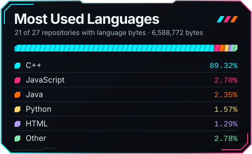

<h2 align="center">Hi 👋, I'm Adam Hamdy</h2>

  I'm a student at the Faculty of Computers and Artificial Intelligence (FCAI), Cairo University. 
  I have a strong passion for learning, improving my skills, and building software projects. 
  I enjoy exploring new technologies and continuously working on becoming a better developer.

  <a href="https://www.youtube.com/@AdamHamdy3">YouTube</a> ·
  <a href="https://www.linkedin.com/in/adam-hamdy-497796371/">LinkedIn</a>

  

  

## Currently working on / learning

- Algorithms — solving problems and reviewing data structures.
- Software projects — building small applications to apply what I learn.

## ⚡ Recent Activity

<!--START_SECTION:activity-->
1. 🎉 Merged PR [#2](https://github.com/Adamhamdy-Curiiie/Adamhamdy-Curiiie/pull/2) in [Adamhamdy-Curiiie/Adamhamdy-Curiiie](https://github.com/Adamhamdy-Curiiie/Adamhamdy-Curiiie)
2. 💪 Opened PR [#2](https://github.com/Adamhamdy-Curiiie/Adamhamdy-Curiiie/pull/2) in [Adamhamdy-Curiiie/Adamhamdy-Curiiie](https://github.com/Adamhamdy-Curiiie/Adamhamdy-Curiiie)
3. 🎉 Merged PR [#1](https://github.com/Adamhamdy-Curiiie/Adamhamdy-Curiiie/pull/1) in [Adamhamdy-Curiiie/Adamhamdy-Curiiie](https://github.com/Adamhamdy-Curiiie/Adamhamdy-Curiiie)
4. 💪 Opened PR [#1](https://github.com/Adamhamdy-Curiiie/Adamhamdy-Curiiie/pull/1) in [Adamhamdy-Curiiie/Adamhamdy-Curiiie](https://github.com/Adamhamdy-Curiiie/Adamhamdy-Curiiie)
<!--END_SECTION:activity-->

  <picture>
    <source media="(prefers-color-scheme: dark)" srcset="https://raw.githubusercontent.com/Adamhamdy-Curiiie/Adamhamdy-Curiiie/output/github-contribution-grid-snake-dark.svg" />
    <source media="(prefers-color-scheme: light)" srcset="https://raw.githubusercontent.com/Adamhamdy-Curiiie/Adamhamdy-Curiiie/output/github-contribution-grid-snake.svg" />
    
  </picture>

  

